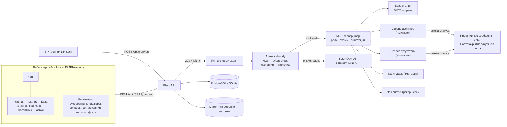

# Архитектура AI-buddy

## Ключевые решения

| Решение | Почему |
|---|---|
| **Python + Flask** | Кейс допускает Python/Flask «в отдельных случаях»; ML/LLM-экосистема и скорость прототипирования. Сервисный слой изолирован — при переносе в Go меняются транспорт и модели, контракты MCP остаются. |
| **Все действия — через MCP** | Агент не ходит в сервисы напрямую. Один контракт для агента, UI и внешних ИИ-агентов Авито (инструменты настройки агентов с MCP). Роли проверяются на уровне сервера инструментов. |
| **Детерминированный роутинг + LLM для синтеза** | Изменяющие действия не зависят от галлюцинаций: намерение и слоты извлекаются кодом, LLM отвечает только по найденным материалам. Без ключа прототип полностью работает. |
| **Подтверждение каждой операции** | Карточка с редактируемыми полями → отдельный вызов. Стажёр видит, что уйдёт в корпоративный сервис, и может поправить. |
| **Асинхронный чат** | `POST /api/chat/send` → `202` за миллисекунды; ответ — по опросу задачи. Медленная LLM/сервис не блокирует UI, ошибки показываются с «Повторить». |
| **Права до retrieval** | Фильтр видимости применяется до ранжирования и до передачи в LLM: недоступное не может «просочиться» в ответ. |
| **Автозакрытие задач по событиям** | Выдача доступов, подтверждённая встреча 1:1, вступление в каналы, первая цель в трекере закрывают задачи чек-листа сами — меньше ручной рутины. |

## Соответствие стеку Авито

| Авито | В прототипе | Как подключить в проде |
|---|---|---|
| Go-сервисы, RPC | Python-модули `app/services/*` | заменить модуль клиентом RPC с тем же интерфейсом |
| Авторизация, ролевая модель, данные сотрудников | сессия + роли `intern/mentor/lead/admin`, синтетические профили | SSO-токен → `current_user()`; профиль и оргструктура из сервиса данных сотрудников |
| ИИ-агенты с промптами и MCP | `app/mcp`, `app/agent/prompts.py` | зарегистрировать MCP-сервер и промпт в платформе агентов |
| ИИ-крон | `POST /api/cron/run` (+ сервис `cron` в compose) | расписание во внутреннем ИИ-кроне |
| Feature flags (runtime) | таблица `feature_flag`, переключатели у руководителя | заменить `analytics.flag()` клиентом сервиса флагов |
| Kafka | `access.sync()` при обращении/кроне | консьюмер событий сервисов заявок |
| Clickstream, Grafana | таблица `analytics_event`, страница «Метрики» | отправка событий в clickstream, дашборды в Grafana |
| PostgreSQL | SQLAlchemy, Postgres в docker-compose | как есть |
| React, TypeScript, TanStack, Zustand, Zod | серверные шаблоны + явный JS API-клиент (`static/js/api.js`) | API уже отделён: SPA на React/TanStack Query подключается к тем же `/api/*`; схемы ответов → Zod |

## Модель прав
- `intern` — свои данные, чек-лист, заявки, вопросы наставнику; материалы `audience=all` своей команды.
- `mentor` — + свои стажёры, ответы на их вопросы, материалы для наставников.
- `lead` — + согласование отсутствий, целей и доступов как владелец проекта, флаги, материалы для руководителей.
- `admin` (куратор стажировки) — создание кабинетов, закрепление наставника и руководителя, сброс паролей,
  отключение кабинетов; видит метрики по всем стажёрам. Чужие чаты, заметки и заявки куратору недоступны.

Почему нужны и наставник, и руководитель: наставник сопровождает ежедневно (вопросы, ревью, 1:1), руководитель
отвечает за команду и проекты — согласует цели на испытательный срок, отсутствия и доступы как владелец проектов.

## Метрики пользы и проверка эффекта
Базовые показатели стажёров Авито (приблизительно) и цели прототипа — `app/metrics.py::BASELINE`:

| Показатель | Сейчас | Цель | Рычаг AI-buddy |
|---|---|---|---|
| Время до первой самостоятельной задачи | ~2 недели | ≤ 1,5 недели | доступы и материалы в первые дни, следующие шаги |
| Длительность адаптации | ~2 месяца | ~6 недель | чек-лист с автозакрытием и напоминаниями |
| Нагрузка на наставника (первые 2–3 мес.) | ~5 ч/нед | ≤ 3,5 ч/нед | оргвопросы и повторы закрывает AI-buddy |
| Удовлетворённость чек-листом | 68% | ≥ 80% | интерактивный чек-лист |
| Удовлетворённость онбордингом / наставником | 9/10 / 90% | не ниже | guardrail |

Каждый вопрос в чате относится к одной из пяти тем обращений к наставнику (`nlu.categorize`): организационные,
по задачам, профессиональные, развитие, обратная связь. Страница «Метрики» показывает по темам, что закрыл AI-buddy
и что ушло наставнику, а также оценку снятых часов наставника в неделю на стажёра. Эффект проверяется A/B на потоке
стажёров через runtime-флаг.
